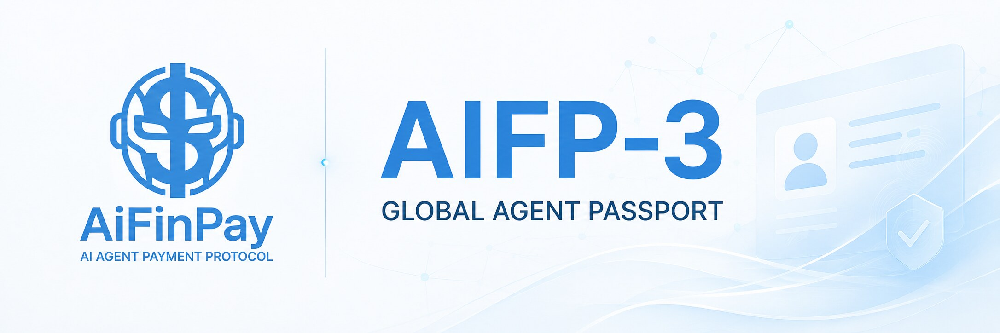
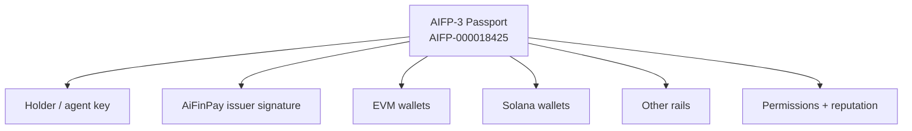
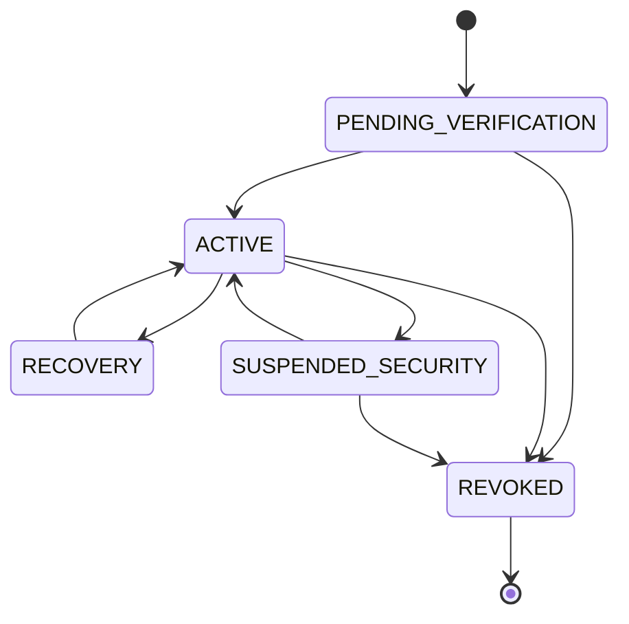
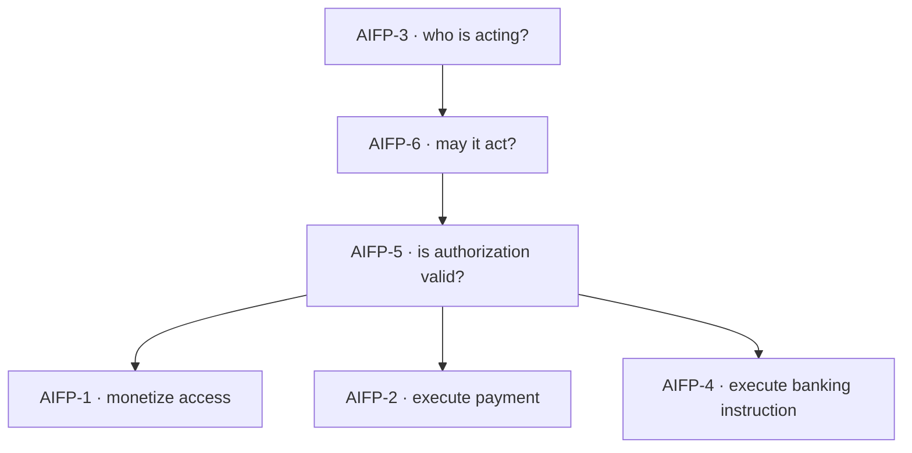

<p align="center">
  
</p>

<h1 align="center">AiFinPay AIFP-3 Agent Passport</h1>

<p align="center">
  <strong>Portable identity, permissions, wallet bindings and financial reputation for autonomous agents.</strong>
</p>

<p align="center">
  <a href="docs/index.md"></a>
  <a href="docs/protocol-specification.md"></a>
  <a href="LICENSE"></a>
  <a href="ROADMAP.md"></a>
</p>

<p align="center">
  <a href="https://aifinpay.io">Website</a> ·
  <a href="docs/index.md">Documentation</a> ·
  <a href="https://github.com/AiFinPay/sdk">SDK &amp; MCP</a> ·
  <a href="https://github.com/AiFinPay/AIFP-2">Agent payments</a>
</p>

---

## One agent. One passport. Many wallets and networks.

AIFP-3 gives an autonomous agent a permanent global identity that is not owned by one blockchain or wallet. A passport can bind multiple independently verified wallets across EVM, Solana and future rails while preserving one `agent_id`, one permanent AIFP number and one lifecycle.



The passport is a portable credential and registry record. It is not an ERC-721 and it has no single owner wallet. Choosing one wallet as an NFT owner would recreate the incorrect `wallet = passport` model.

## Canonical identity model

| Object | Rule |
|---|---|
| `agent_id` | Globally unique, immutable internal identifier |
| `passport_number` | Permanent human-readable number such as `AIFP-000018425` |
| Holder key | Agent/controller proof key; independently rotatable under recovery rules |
| Issuer key | AiFinPay-controlled signing key; never disclosed to the agent |
| Wallet bindings | Zero or more verified addresses across supported networks |
| Protected metadata | Canonical issuer-signed fields; unauthorized change fails closed |
| Status | One lifecycle applied across sessions and AiFinPay payment permissions |

## Dual-signature trust model

```text
issuer signature → proves AiFinPay issued the canonical passport claims
holder signature → proves the agent/controller controls the current holder key
wallet proof      → proves control of each independently bound wallet
```

The issuer key is not a second agent key and cannot be replaced by the agent. The holder key does not authorize changes to issuer-protected identity fields.

## Lifecycle



When a confirmed attempt modifies protected metadata without a valid issuer update, the passport moves to `SUSPENDED_SECURITY`. AiFinPay sessions, wallet bindings and payment authorization fail closed until reviewed. External self-custody wallets cannot be frozen on their blockchain; AiFinPay can block their use inside its own protocol and can freeze compatible guardian-controlled smart wallets.

## Privacy and minimal disclosure

Passport verification should disclose only what a relying party needs. A verifier may confirm status, wallet binding, permission or reputation threshold without receiving private profile data. Telegram or other source aliases may be recorded as issuer-attested aliases; they are not the immutable identity root.

## Documentation

| Start here | Document |
|---|---|
| Normative behavior | [Protocol specification](docs/protocol-specification.md) |
| Components and trust boundaries | [Architecture](docs/architecture.md) |
| Identity and protected fields | [Identity model](docs/identity-model.md) |
| Holder, issuer and rotation rules | [Key model](docs/key-model.md) |
| Multiple wallets and ownership proofs | [Wallet bindings](docs/wallet-bindings.md) |
| Status, suspension and recovery | [Lifecycle](docs/lifecycle.md) |
| Threats and required controls | [Security model](docs/security-model.md) |
| Data minimization | [Privacy model](docs/privacy-model.md) |
| SDK/API/payment integration | [Integration guide](docs/integration-guide.md) |
| Real repositories, PRs and migration status | [Implementation map](docs/implementation-map.md) |
| Machine-readable API | [OpenAPI 3.1](spec/openapi.yaml) |
| JSON objects | [Schemas](schemas/) |

## Implementation status

The Global Agent Passport vNext implementation is currently split between [backend PR #33](https://github.com/AiFinPay/aifinpay-web/pull/33) and [SDK PR #27](https://github.com/AiFinPay/sdk/pull/27). Both report passing CI, but both remain **open draft pull requests and are not merged**. They contain the global identity, permanent number, issuer/holder key model, wallet ownership proof, rotation, revoke and administrative lifecycle surfaces.

The existing [`AgentPassport.sol`](https://github.com/AiFinPay/evm-contract/blob/main/contracts/AgentPassport.sol) is a legacy wallet-owned ERC-721 model, not the canonical vNext identity. Smart-contract migration, production deployment and cross-component E2E acceptance remain pending. Payment enforcement must remain disabled by default until those gates pass (`AIFP3_ENFORCE_PAYMENTS=false`).

There is no separate canonical repository named `agent-passport`: this AIFP-3 repository is the public protocol, while backend, SDK and chain implementations live in their respective repositories. See the [implementation map](docs/implementation-map.md).

## One system, six protocols

See the complete [AiFinPay protocol-family architecture](docs/protocol-family.md).



| Protocol | Responsibility |
|---|---|
| [AIFP-1](https://github.com/AiFinPay/AIFP-1) | Merchant AI-traffic and digital-resource monetization |
| [AIFP-2](https://github.com/AiFinPay/AIFP-2) | Programmable x402-compatible agent payments |
| **AIFP-3** | Portable agent identity, wallet bindings and status |
| [AIFP-4](https://github.com/AiFinPay/AIFP-4) | Banking and SWIFT execution layer |
| [AIFP-5](https://github.com/AiFinPay/AIFP-5-Quantum-Safe-Financial-Protocol)¹ | Classical, hybrid and post-quantum authorization |
| [AIFP-6](https://github.com/AiFinPay/AIFP-6-Agentic-Financial-Governance-Protocol)¹ | Financial policy, delegation, approvals and audit |

¹ AIFP-5 and AIFP-6 are currently private repositories; the links resolve for authorized organization members.

## License

Code, examples, schemas and machine-readable artifacts are licensed under Apache License 2.0. Documentation and prose specifications are licensed under CC BY 4.0 unless a file states otherwise. See [LICENSE](LICENSE) and [NOTICE](NOTICE).
