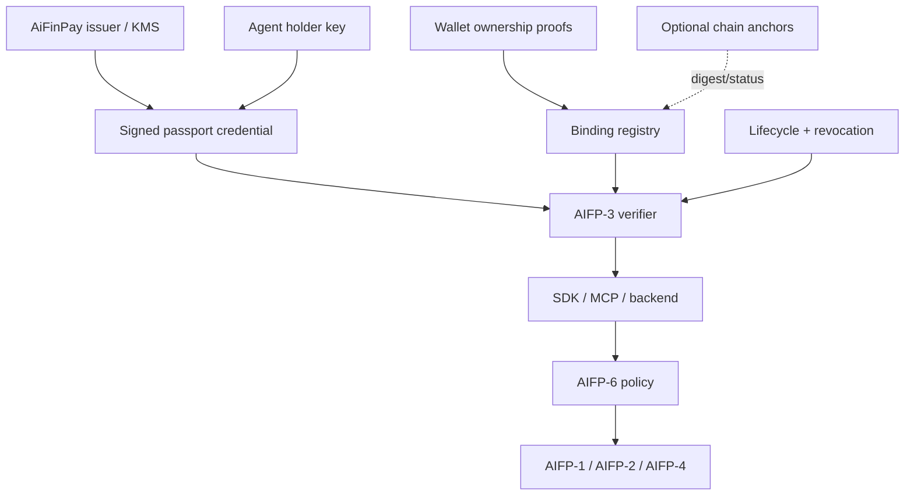

# Architecture

## Trust boundaries

| Component | Trusted for | Not trusted for |
|---|---|---|
| Issuer/KMS | issuer signatures and protected-claim updates | holder consent by itself |
| Holder key | holder-authorized commands | issuer-protected claim changes |
| Wallet proof verifier | address-control proof | agent identity by itself |
| Registry | current version, bindings and audit state | cryptographic proof without verification |
| Relying party | its own access decision | rewriting passport state |
| Chain anchor | immutable digest/status evidence | private credential storage |

## Storage separation

- **Public credential:** minimum portable claims and signatures.
- **Private profile:** recovery, private aliases and sensitive reputation evidence.
- **Registry:** lifecycle, versions, wallet bindings and audit references.
- **On-chain anchor:** digest/status only where useful.

The issuer private key belongs in a hardened KMS/HSM boundary with rotation and separation of duties. It must never appear in the credential, application logs or agent environment.

