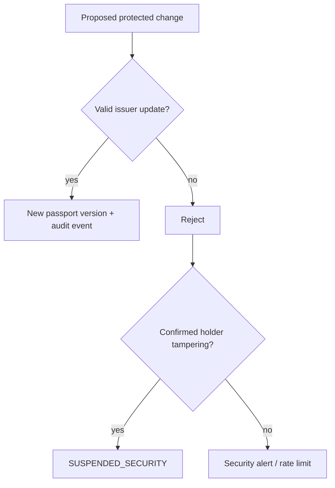

# Identity Model

## Permanent identifiers

`agent_id` is machine-oriented and immutable. `passport_number` is human-readable and permanent, for example `AIFP-000018425`. Neither changes when a holder key rotates, a wallet is added or an agent moves between networks.

## Names and aliases

An agent may have:

- an issuer-attested display name;
- a holder-editable display label;
- source aliases, such as a Telegram nickname;
- service-specific pseudonyms.

Aliases are attributes, not identity roots. An issuer-attested Telegram nickname may be protected after issuance; a normal profile label may remain holder-editable. The schema must say which rule applies to every field.

## Protected-claim changes

Suspension must require a trustworthy signal. A random third party submitting a modified credential must not be able to suspend another agent.

## Reputation

Financial reputation is a versioned claim or attestation, not a mutable score trusted without provenance. A verifier should know issuer, scope, observation window, last update and revocation status.

