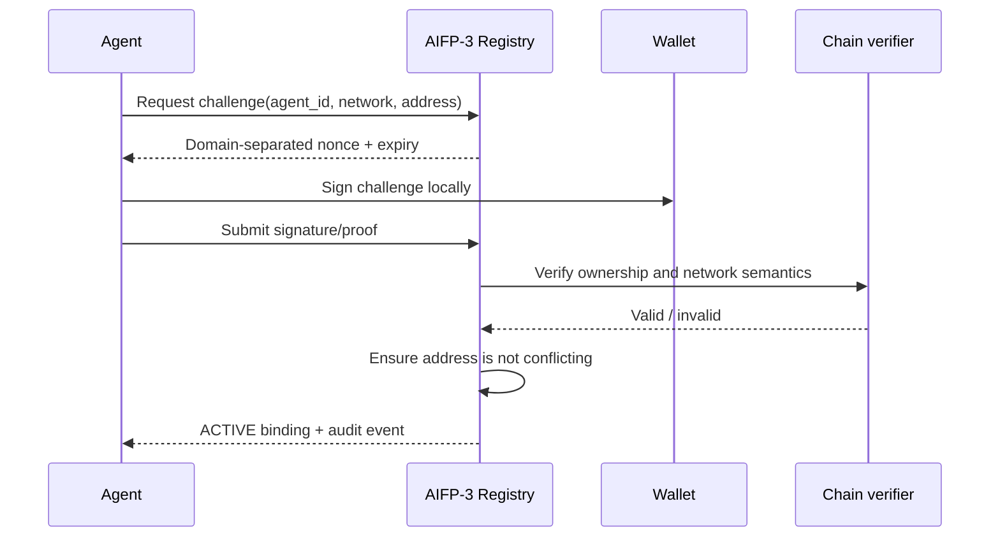

# Wallet Bindings

## Core rule

One passport may bind many wallets. Each binding proves control independently and can be suspended or revoked without changing the passport identity.

## Binding flow

## Binding fields

- `binding_id`
- `agent_id`
- network namespace and reference
- normalized wallet address
- proof type and proof digest
- `verified_at`
- status: `ACTIVE`, `SUSPENDED`, `REVOKED`
- optional wallet class: external EOA/account, smart wallet or organizational/shared profile

## Freezing limits

AIFP-3 can block an external wallet from AiFinPay routes but cannot freeze that wallet or its funds on the underlying blockchain. A compatible smart wallet with an authorized guardian may implement on-chain freeze/recovery under its own rules.

